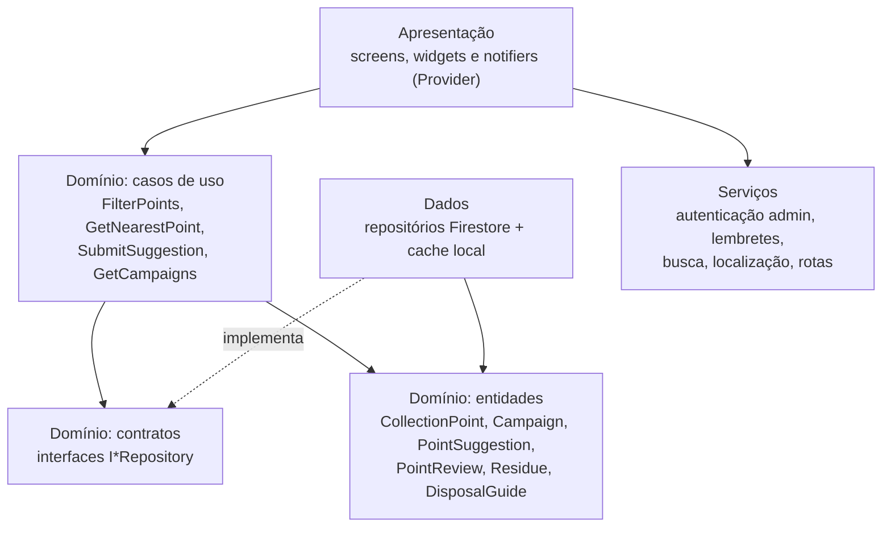
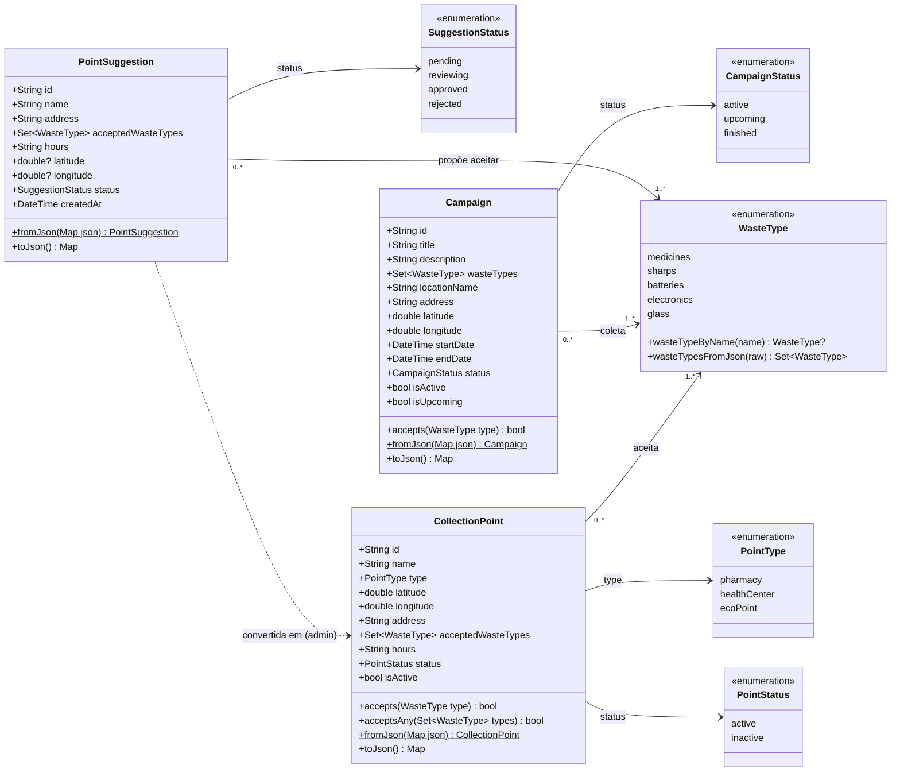
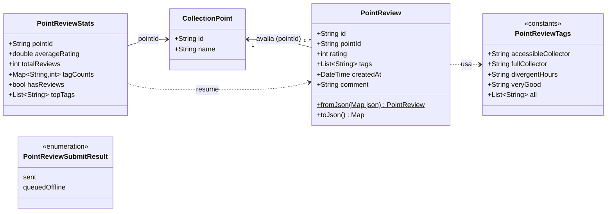
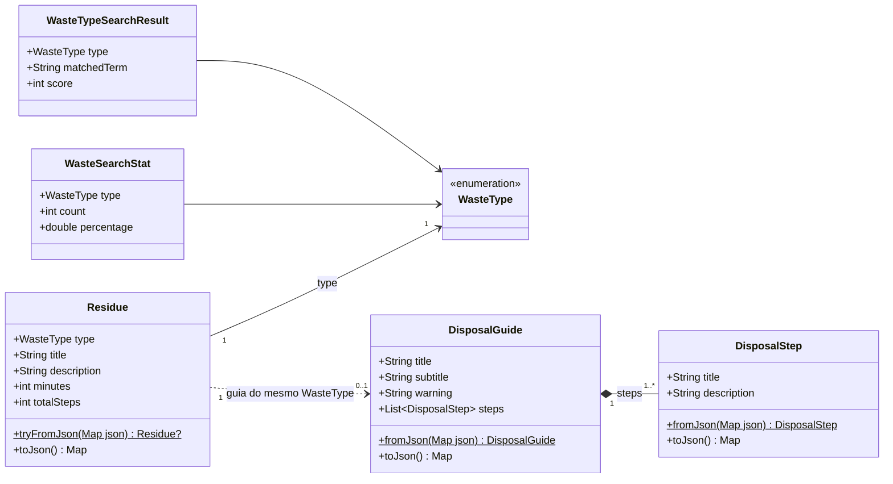
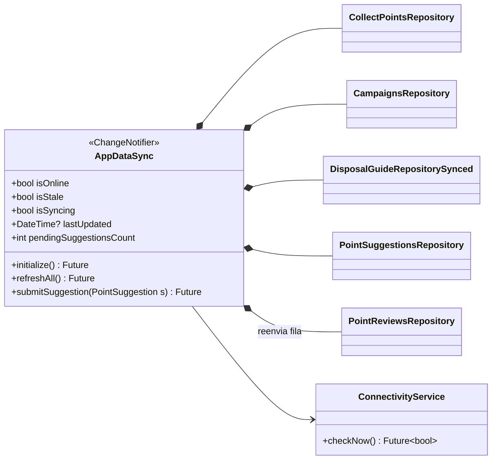
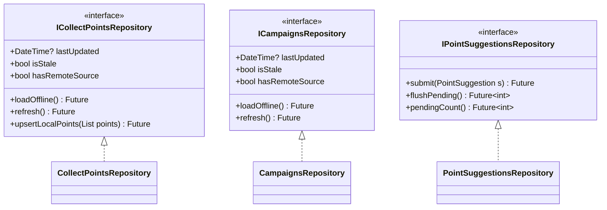
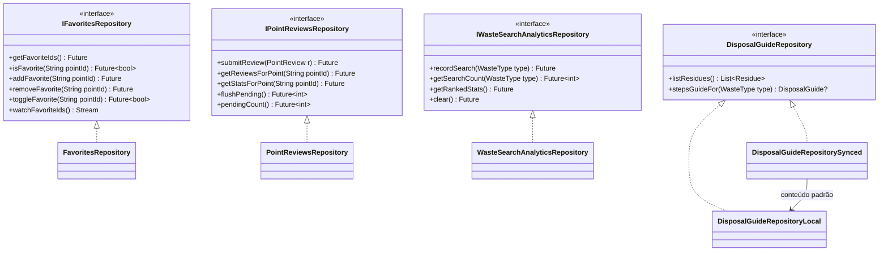
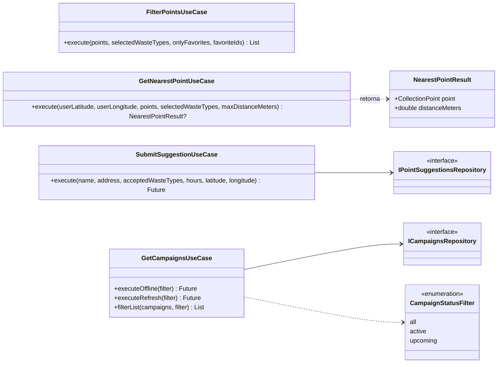
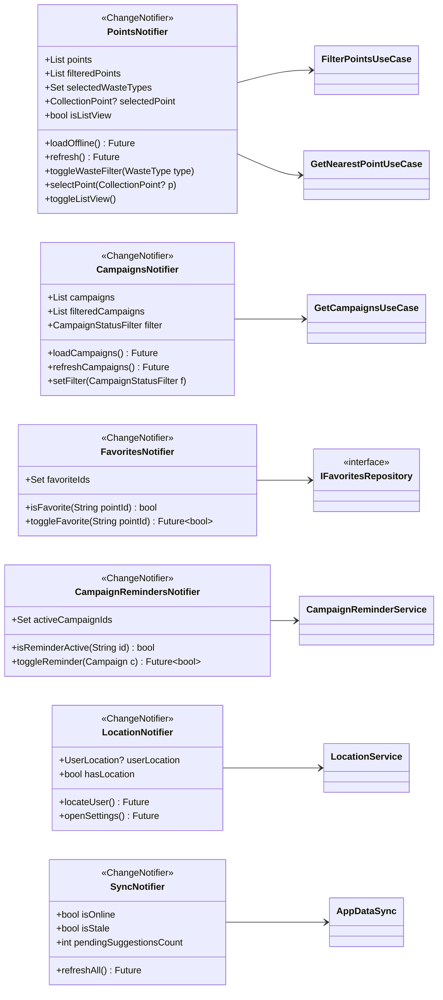
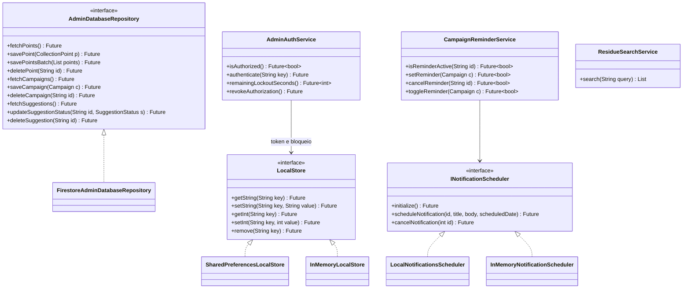

# Diagrama de Classes — Modelos de Domínio

O EcoMonitor não possui uma entidade `Usuario`: o cidadão usa o app sem cadastro (RNF07), e sugestões e avaliações são anônimas (RF11, RNF06). Favoritos e lembretes ficam salvos apenas no aparelho. O administrador também não é uma entidade persistida; ele é identificado apenas pela chave de acesso validada no `AdminAuthService`.

As entidades centrais giram em torno do **tipo de resíduo** (`WasteType`), que liga pontos de coleta, campanhas, sugestões e guias de descarte. As entidades ficam em `lib/domain/entities` (a pasta `lib/models` apenas reexporta esses arquivos).

## Arquitetura em camadas

A apresentação depende dos **contratos** (interfaces), e não das classes concretas. As implementações são injetadas pelo `buildAppProviders` (`lib/presentation/state/app_providers.dart`).

## 1. Entidades de domínio

### 1.1 Pontos de coleta, campanhas e sugestões

### 1.2 Avaliações de pontos

### 1.3 Guia de descarte e buscas

### Relacionamentos

| Relação | Tipo | Significado |
|---|---|---|
| `CollectionPoint` → `WasteType` | Associação (N:N) | Um ponto aceita um ou mais tipos de resíduo; o filtro do mapa usa `acceptsAny`. |
| `Campaign` → `WasteType` | Associação (N:N) | Uma campanha coleta um ou mais tipos de resíduo. |
| `PointSuggestion` → `WasteType` | Associação (N:N) | O cidadão informa quais resíduos o local sugerido aceitaria. |
| `PointSuggestion` ⇢ `CollectionPoint` | Dependência | O administrador pode converter uma sugestão em ponto de coleta (RN07). |
| `PointReview` → `CollectionPoint` | Associação (N:1) | Cada avaliação referencia um ponto pelo `pointId`; um ponto pode ter várias avaliações. |
| `PointReviewStats` ⇢ `PointReview` | Dependência | Estatísticas (média e tags mais votadas) calculadas a partir das avaliações. |
| `Residue` → `WasteType` | Associação (1:1) | Cada item do guia representa um tipo de resíduo. |
| `Residue` ⇢ `DisposalGuide` | Dependência | O passo a passo é encontrado pelo `WasteType` do resíduo (`stepsGuideFor`). |
| `DisposalGuide` ◆ `DisposalStep` | Composição | Os passos só existem dentro do guia. |
| `WasteSearchStat` → `WasteType` | Associação | Contagem de buscas por tipo de resíduo, usada no ranking do guia. |

## 2. Camada de dados e serviços

As telas não acessam o Firestore diretamente. Elas usam **casos de uso** e **notifiers** que dependem de contratos (`I*Repository`). As implementações concretas, coordenadas pelo `AppDataSync`, decidem entre dados remotos, cache local e dados empacotados no app (offline-first). Para facilitar a leitura, a camada foi dividida em diagramas menores.

### 2.1 Coordenação da sincronização

### 2.2 Contratos de domínio: pontos, campanhas e sugestões

### 2.3 Contratos de domínio: favoritos, avaliações, buscas e guia

### 2.4 Casos de uso

### 2.5 Camada de apresentação (estado com Provider)

### 2.6 Painel administrativo e serviços

### Responsabilidades

| Classe | Responsabilidade |
|---|---|
| `AppDataSync` | Raiz de composição dos dados. Inicializa os repositórios, monitora a conectividade e, ao reconectar, atualiza os dados e reenvia as filas de sugestões e avaliações. |
| `CollectPointsRepository` / `CampaignsRepository` | Leem do Firestore, gravam cache versionado no `SharedPreferences` e caem para o JSON empacotado em `assets/data` quando não há rede nem cache. |
| `DisposalGuideRepository` | Contrato usado pelas telas do guia. A versão `Synced` mescla o conteúdo remoto com o local, garantindo o guia offline (RNF09). |
| `PointSuggestionsRepository` / `PointReviewsRepository` | Enviam dados anônimos ao Firestore e mantêm filas offline protegidas por mutex (RN04, RN19). |
| `FavoritesRepository` | Guarda os IDs dos pontos favoritos no aparelho (RN18). |
| `WasteSearchAnalyticsRepository` | Conta buscas por tipo de resíduo e gera o ranking com percentual (RN23). |
| Casos de uso | Concentram as regras de negócio independentes de tela: filtro de pontos, ponto mais próximo, validação de sugestão e filtro de campanhas. |
| Notifiers | Guardam o estado das telas e avisam a interface quando ele muda (padrão Provider + `ChangeNotifier`). |
| `CampaignReminderService` | Agenda e cancela as notificações locais dos lembretes de campanha (RN21). |
| `ResidueSearchService` | Encontra o tipo de resíduo a partir de termos populares e sinônimos (RN22). |
| `AdminDatabaseRepository` | Operações de CRUD do painel administrativo, incluindo gravação de pontos em lote. |
| `AdminAuthService` | Valida a chave do administrador com SHA-256 e aplica o bloqueio por tentativas (RN05, RN06). |
| `LocalStore` | Abstração de armazenamento local, com versão real e versão em memória para testes. |
