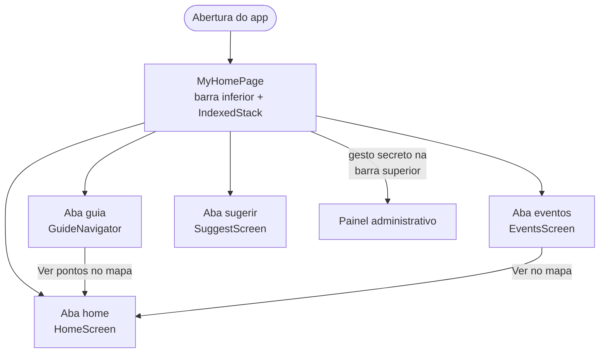
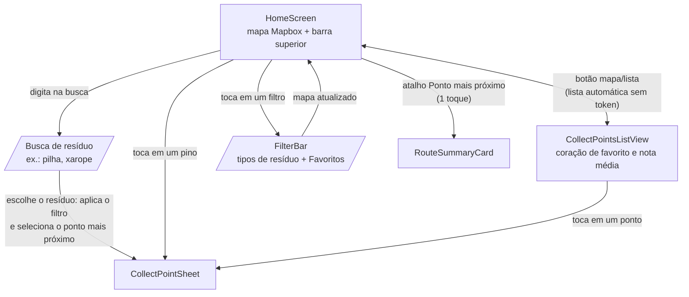
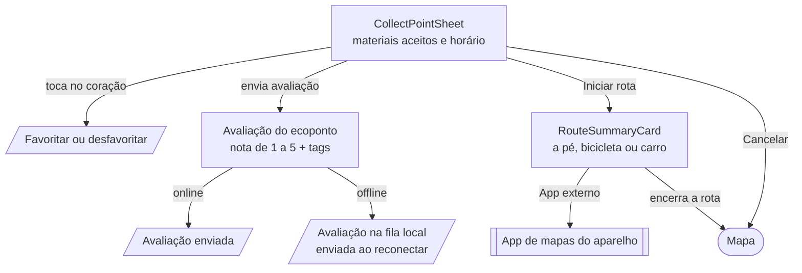
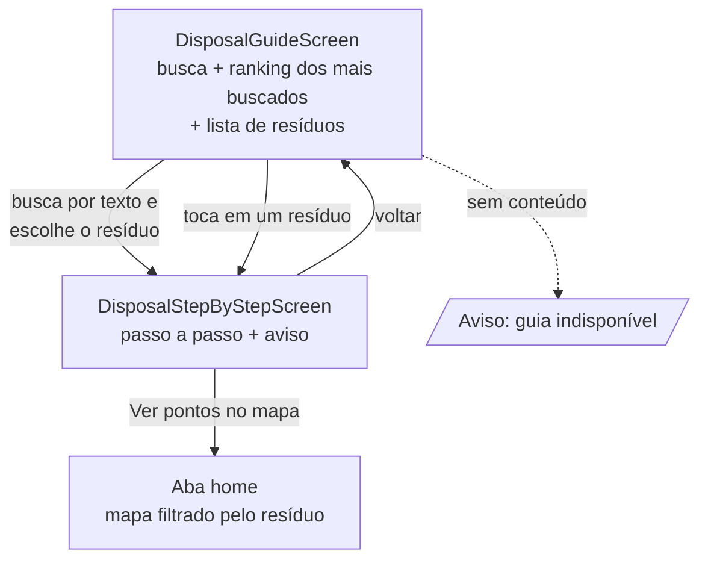
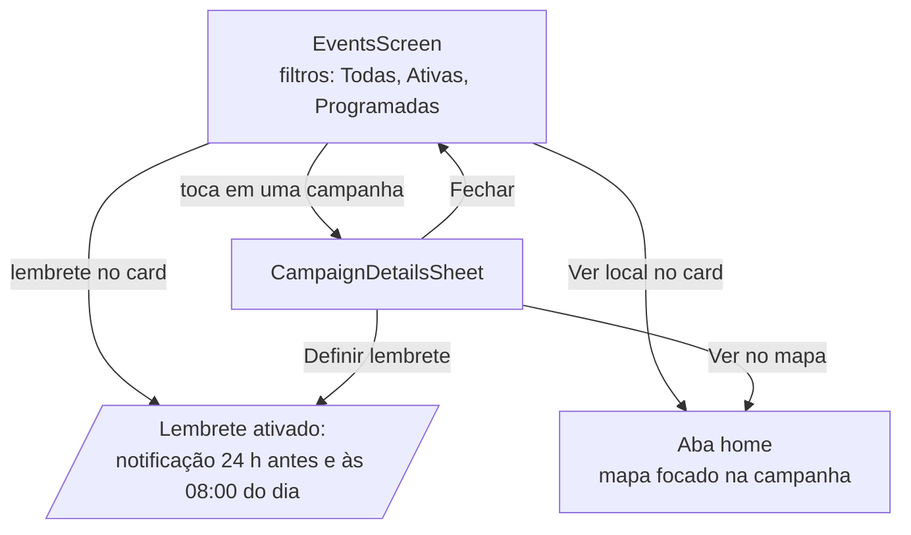
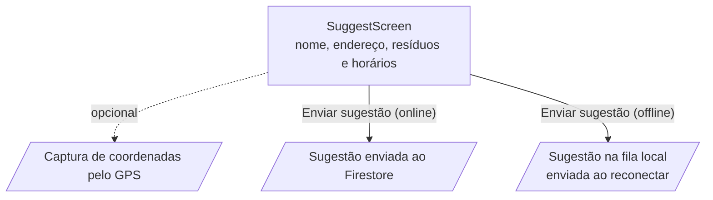
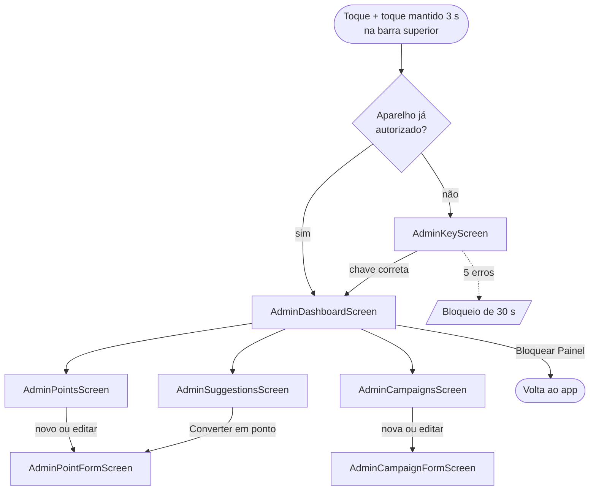

# Fluxo de Navegação

Este documento mostra como as telas do EcoMonitor se conectam na prática, de acordo com o código atual (`lib/main.dart`, `lib/screens` e `lib/widgets`).

## Estrutura geral

O app tem uma **casca única** (`MyHomePage`) com uma barra de navegação inferior (`CustomBottomNavBar`) e quatro abas mantidas em um `IndexedStack`. Trocar de aba não destrói a tela anterior, então o mapa, os filtros e o formulário mantêm o estado.

| Índice | Aba (rótulo) | Tela | Título da barra superior |
|---|---|---|---|
| 0 | home | `HomeScreen` | ECOMONITOR |
| 1 | guia | `GuideNavigator` → `DisposalGuideScreen` | Própria de cada tela do guia |
| 2 | eventos | `EventsScreen` | CAMPANHAS ATIVAS |
| 3 | sugerir | `SuggestScreen` | SUGERIR NOVO PONTO |

A aba **guia** tem um `Navigator` próprio (aninhado). Por isso, abrir o passo a passo não esconde a barra inferior, e o botão voltar do Android primeiro fecha o passo a passo e depois leva para a aba home, sem fechar o app.

O **painel administrativo** fica fora das abas: é aberto por um gesto secreto na barra superior e empilhado sobre o app com `Navigator.push`.

## Diagramas de navegação

Para ficar legível, a navegação foi dividida em um diagrama geral e um diagrama para cada aba e para o painel administrativo.

### Visão geral

### Aba home: mapa, busca e filtros

### Aba home: detalhes do ponto e rota

### Aba guia

### Aba eventos

### Aba sugerir

### Painel administrativo

## Fluxos principais

### 1. Encontrar um ponto e ir até ele (RF01–RF04, RF14)
`home` → mapa com os pontos → toque no pino → `CollectPointSheet` → **Iniciar rota** → `RouteSummaryCard` (escolha do modo e distância/tempo) → opcionalmente **App externo**.

Atalho: o botão de **ponto mais próximo** na barra superior faz tudo em um toque. Ele pede a localização (se ainda não tiver), seleciona o ponto ativo mais próximo compatível com o filtro e já inicia a rota.

### 1.1 Buscar um resíduo pelo nome
Na barra superior do mapa, o usuário digita um termo popular (ex.: “pilha”, “xarope”). Ao escolher o resíduo, o mapa é filtrado e, se a localização estiver disponível, o ponto compatível mais próximo é selecionado.

### 1.2 Favoritar e avaliar um ponto
No `CollectPointSheet` (ou no card da lista), o coração adiciona o ponto aos favoritos. O filtro **Favoritos** da `FilterBar` mostra só esses pontos. No mesmo card, a seção **Avaliação do ecoponto** permite dar nota de 1 a 5 e marcar tags como “Coletor cheio”. Sem internet, a avaliação fica na fila e é enviada depois.

### 2. Do guia ao ponto de coleta (RF06, RF07, RF12, RF13)
`guia` → `DisposalGuideScreen` (com busca por texto e ranking dos resíduos mais buscados) → escolhe o resíduo → `DisposalStepByStepScreen` → **Ver pontos no mapa** → o app fecha o passo a passo, troca para a aba `home` e aplica o filtro daquele resíduo no mapa. O filtro pode ser removido na própria `FilterBar`.

### 3. Da campanha ao mapa (RF08, RF09)
`eventos` → escolhe o filtro (Todas, Ativas ou Programadas) → toca na campanha → `CampaignDetailsSheet` → **Ver no mapa** → aba `home` centralizada no local da campanha. O botão **Ver local** do card faz o mesmo sem abrir os detalhes.

### 3.1 Lembrete de campanha
No card ou nos detalhes da campanha, **Definir lembrete** agenda duas notificações no aparelho: 24 horas antes do início e às 08:00 do dia de início. Tocar de novo cancela o lembrete.

### 4. Sugerir um novo ponto (RF10, RF11)
`sugerir` → preenche nome, endereço, tipos de resíduo e horários (opcionalmente captura as coordenadas pelo GPS) → **Enviar sugestão**. Com internet, a sugestão vai direto para o Firestore. Sem internet, fica na fila local; o banner superior mostra quantas estão pendentes e o envio acontece sozinho quando a conexão volta.

### 5. Administração (RNF11)
Gesto secreto na barra superior → `AdminKeyScreen` (ou direto no `AdminDashboardScreen` se o aparelho já foi autorizado) → gerenciar **pontos**, **campanhas** ou **sugestões**. Os formulários devolvem `true` ao salvar, e a lista anterior recarrega os dados. O botão **Bloquear Painel** revoga a autorização do aparelho e volta para o app. O painel também permite forçar a sincronização dos dados com o banco.

## Elementos presentes em todas as abas

- **`EcoAppBar`**: barra superior com o título da aba e a área do gesto secreto do painel.
- **`OfflineBanner`**: aviso em forma de pílula logo abaixo da barra superior. Aparece quando não há conexão, quando os dados estão desatualizados ou quando há sugestões na fila, e permite tentar sincronizar de novo.
- **`CustomBottomNavBar`**: barra inferior flutuante com as quatro abas.
