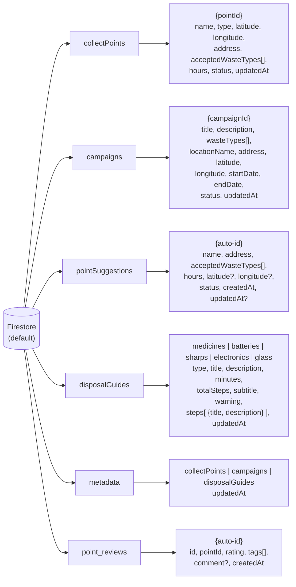
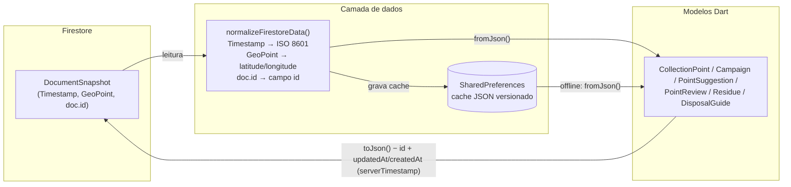

# Modelagem do Banco de Dados — Firebase Cloud Firestore

O EcoMonitor usa o **Cloud Firestore**, banco NoSQL orientado a documentos. Os dados ficam em **coleções** de **documentos**, e cada documento é um conjunto de campos chave-valor. Não há tabelas, chaves estrangeiras nem joins: os relacionamentos são representados por valores repetidos (como a lista de tipos de resíduo) ou pelo próprio ID do documento.

Projeto Firebase: `eco-monitor-34290`.

## 1. Estrutura de coleções e documentos



### Resumo das coleções

| Coleção | ID do documento | Quem escreve | Quem lê | Requisitos |
|---|---|---|---|---|
| `collectPoints` | Gerado pelo Firestore ou definido no seed | Administrador (painel, inclusive em lote) e scripts de seed (`seed_firestore.dart`, `seed_aracaju_points.dart`) | Todos os usuários | RF01–RF05, RF13, RNF11 |
| `campaigns` | Gerado pelo Firestore ou slug do seed (ex.: `mutirao-eletronicos-orla`) | Administrador e seed | Todos os usuários | RF08, RF09, RNF11 |
| `pointSuggestions` | Gerado automaticamente (`add()`) | Cidadão (envio anônimo) | Administrador | RF10, RF11, RNF06 |
| `disposalGuides` | Nome do tipo de resíduo (`medicines`, `batteries`, `sharps`, `electronics`, `glass`) | Seed | Todos os usuários | RF06, RF07, RNF09 |
| `point_reviews` | Gerado automaticamente (`add()`) | Cidadão (avaliação anônima) | Reservado para consultas futuras; hoje as médias são calculadas no aparelho | RNF06, RNF14 |
| `metadata` | Nome da coleção monitorada | Administrador e seed | Todos os usuários | RNF10, RNF11 |

### Documentos de exemplo

**`collectPoints/{pointId}`**

```json
{
  "name": "Farmácia Exemplo — Centro",
  "type": "pharmacy",
  "latitude": -10.9111,
  "longitude": -37.0488,
  "address": "Rua Exemplo, 100 — Centro, Aracaju",
  "acceptedWasteTypes": ["batteries", "medicines"],
  "hours": "Seg a Sex, 08:00–18:00",
  "status": "active",
  "updatedAt": "<Timestamp do servidor>"
}
```

**`campaigns/{campaignId}`**

```json
{
  "title": "Mutirão de Lixo Eletrônico na Orla",
  "description": "Coleta gratuita de celulares antigos, carregadores, pilhas e pequenos eletrodomésticos.",
  "wasteTypes": ["batteries", "electronics"],
  "locationName": "Arcos da Orla de Atalaia",
  "address": "Av. Santos Dumont, s/n — Atalaia, Aracaju",
  "latitude": -10.9896,
  "longitude": -37.0432,
  "startDate": "<Timestamp 2026-11-15T08:00:00Z>",
  "endDate": "<Timestamp 2026-11-30T17:00:00Z>",
  "status": "active",
  "updatedAt": "<Timestamp do servidor>"
}
```

**`pointSuggestions/{auto-id}`** (sem nenhum dado do usuário)

```json
{
  "name": "Mercado do bairro",
  "address": "Av. Exemplo, 500 — Jabotiana, Aracaju",
  "acceptedWasteTypes": ["batteries"],
  "hours": "Seg a Sex: 08:00 às 18:00 · Sáb: 08:00 às 12:00",
  "latitude": -10.95,
  "longitude": -37.08,
  "status": "pending",
  "createdAt": "<Timestamp do servidor>"
}
```

**`disposalGuides/medicines`**

```json
{
  "type": "medicines",
  "title": "Remédios vencidos",
  "description": "Comprimidos, xaropes e pomadas. Nunca jogue no lixo comum ou no vaso.",
  "minutes": 2,
  "totalSteps": 4,
  "subtitle": "Siga os passos antes de ir até o ponto.",
  "warning": "Não jogue no lixo comum, pia ou vaso sanitário.",
  "steps": [
    { "title": "Separe os medicamentos", "description": "Junte os vencidos ou que não usa mais." },
    { "title": "Mantenha na embalagem", "description": "Deixe na cartela ou frasco original, se possível." }
  ],
  "updatedAt": "<Timestamp>"
}
```

**`point_reviews/{auto-id}`** (sem nenhum dado do usuário)

```json
{
  "id": "rev_1795450000000",
  "pointId": "ecoponto-exemplo",
  "rating": 4,
  "tags": ["Coletor acessível", "Muito bom"],
  "createdAt": "<Timestamp do servidor>"
}
```

**`metadata/collectPoints`**

```json
{ "updatedAt": "<Timestamp do servidor>" }
```

### Índices compostos (`firestore.indexes.json`)

| Coleção | Campos | Uso |
|---|---|---|
| `collectPoints` | `status` ↑, `name` ↑ | Listar pontos por status em ordem alfabética |
| `campaigns` | `status` ↑, `startDate` ↑ | Listar campanhas por status e data de início |
| `pointSuggestions` | `status` ↑, `createdAt` ↓ | Moderação: sugestões por status, mais recentes primeiro |

### Regras de segurança (`firestore.rules`)

Na versão atual, todas as coleções, incluindo a nova `point_reviews`, têm `allow read, write: if true`. Isso permite o envio anônimo de sugestões e o funcionamento do painel administrativo sem Firebase Authentication. A proteção do painel fica no aplicativo (chave com hash SHA-256). Como evolução, o ideal é restringir a escrita em `collectPoints`, `campaigns`, `disposalGuides` e `metadata` a administradores autenticados e permitir em `pointSuggestions` e `point_reviews` apenas `create` com validação dos campos (por exemplo, `rating` entre 1 e 5).

---

## 2. Mapeamento das classes Dart para o Firestore

### Como a conversão acontece



Os modelos de domínio **não dependem do pacote `cloud_firestore`**. Toda conversão de tipos do Firestore passa pela função `normalizeFirestoreData` (`lib/data/firestore_helpers.dart`), que transforma os dados em JSON puro. Assim, o mesmo `fromJson` serve para o Firestore, para o cache local e para os arquivos em `assets/data`.

### Regras gerais de mapeamento

| Dart | Firestore | Conversão |
|---|---|---|
| Campo `id` da classe | ID do documento (`doc.id`) | Na leitura, `normalizeFirestoreData(documentId: doc.id)` injeta o `id`. Na escrita, o `id` é removido do mapa; se estiver vazio, o Firestore gera um novo ID. |
| `enum` (`PointType`, `PointStatus`, `CampaignStatus`, `SuggestionStatus`) | `string` | Gravado com `.name` (ex.: `"active"`). Valor desconhecido na leitura recebe um padrão seguro (RN08). |
| `Set<WasteType>` | `array<string>` | Gravado como lista ordenada de nomes (`["batteries","medicines"]`). Valores possíveis: `medicines`, `sharps`, `batteries`, `electronics` e `glass`. Na leitura, `wasteTypesFromJson` aceita também nomes antigos no singular (`medicine`, `battery`, `electronic`) e `vidro`, e ignora valores desconhecidos. |
| `double latitude` / `double longitude` | `number` (ou `geopoint`) | Gravados como números. Se algum documento usar `GeoPoint`, a normalização extrai `latitude` e `longitude`. |
| `DateTime` | `timestamp` (ou `string` ISO 8601) | Na leitura, `Timestamp`, `String` ISO e milissegundos viram `DateTime` em UTC. |
| `List<DisposalStep>` | `array<map>` | Cada passo vira um mapa `{title, description}` dentro do documento do guia (composição). |
| `List<String>` | `array<string>` | Usado nas tags de `PointReview`. |
| — | `updatedAt` / `createdAt` | Campos de controle preenchidos com `FieldValue.serverTimestamp()`; não existem como atributo nas classes, exceto `PointSuggestion.createdAt` e `PointReview.createdAt`. |

### `CollectionPoint` → `collectPoints/{id}`

| Atributo Dart | Tipo Dart | Campo Firestore | Tipo Firestore |
|---|---|---|---|
| `id` | `String` | *ID do documento* | — |
| `name` | `String` | `name` | string |
| `type` | `PointType` | `type` | string (`pharmacy`, `healthCenter`, `ecoPoint`) |
| `latitude` | `double` | `latitude` | number |
| `longitude` | `double` | `longitude` | number |
| `address` | `String` | `address` | string |
| `acceptedWasteTypes` | `Set<WasteType>` | `acceptedWasteTypes` | array\<string\> |
| `hours` | `String` | `hours` | string |
| `status` | `PointStatus` | `status` | string (`active`, `inactive`) |
| — | — | `updatedAt` | timestamp (servidor) |

### `Campaign` → `campaigns/{id}`

| Atributo Dart | Tipo Dart | Campo Firestore | Tipo Firestore |
|---|---|---|---|
| `id` | `String` | *ID do documento* | — |
| `title` | `String` | `title` | string |
| `description` | `String` | `description` | string |
| `wasteTypes` | `Set<WasteType>` | `wasteTypes` | array\<string\> |
| `locationName` | `String` | `locationName` | string |
| `address` | `String` | `address` | string |
| `latitude` / `longitude` | `double` | `latitude` / `longitude` | number |
| `startDate` | `DateTime` | `startDate` | timestamp (seed) ou string ISO (painel) |
| `endDate` | `DateTime` | `endDate` | timestamp (seed) ou string ISO (painel) |
| `status` | `CampaignStatus` | `status` | string (`active`, `upcoming`, `finished`) |
| — | — | `updatedAt` | timestamp (servidor) |

### `PointSuggestion` → `pointSuggestions/{auto-id}`

| Atributo Dart | Tipo Dart | Campo Firestore | Tipo Firestore |
|---|---|---|---|
| `id` | `String` | *ID do documento* (gerado por `add()`) | — |
| `name` | `String` | `name` | string |
| `address` | `String` | `address` | string |
| `acceptedWasteTypes` | `Set<WasteType>` | `acceptedWasteTypes` | array\<string\> |
| `hours` | `String` | `hours` | string |
| `latitude` | `double?` | `latitude` | number (omitido se nulo) |
| `longitude` | `double?` | `longitude` | number (omitido se nulo) |
| `status` | `SuggestionStatus` | `status` | string (sempre `pending` no envio) |
| `createdAt` | `DateTime` | `createdAt` | timestamp (servidor) |
| — | — | `updatedAt` | timestamp (gravado quando o admin muda o status) |

### `PointReview` → `point_reviews/{auto-id}`

| Atributo Dart | Tipo Dart | Campo Firestore | Tipo Firestore |
|---|---|---|---|
| `id` | `String` | `id` (o documento recebe outro ID automático) | string (`rev_<milissegundos>`) |
| `pointId` | `String` | `pointId` | string (referência ao ID do documento em `collectPoints`) |
| `rating` | `int` | `rating` | number (1 a 5) |
| `tags` | `List<String>` | `tags` | array\<string\> |
| `createdAt` | `DateTime` | `createdAt` | timestamp (servidor) |
| `comment` | `String` | `comment` | string (omitido quando vazio) |

O relacionamento entre avaliação e ponto é feito pelo campo `pointId`, que guarda o ID do documento do ponto, já que o Firestore não tem chave estrangeira.

### `Residue` + `DisposalGuide` → `disposalGuides/{wasteType}`

Um único documento guarda o resumo exibido na lista do guia (`Residue`) e o passo a passo (`DisposalGuide`). O ID do documento é o nome do `WasteType`.

| Classe | Atributo Dart | Tipo Dart | Campo Firestore | Tipo Firestore |
|---|---|---|---|---|
| `Residue` | `type` | `WasteType` | *ID do documento* ou `type` | string |
| `Residue` | `title` | `String` | `title` | string |
| `Residue` | `description` | `String` | `description` | string |
| `Residue` | `minutes` | `int` | `minutes` | number |
| `Residue` | `totalSteps` | `int` | `totalSteps` | number (calculado pelos passos se vier 0) |
| `DisposalGuide` | `subtitle` | `String` | `subtitle` | string |
| `DisposalGuide` | `warning` | `String` | `warning` | string |
| `DisposalGuide` | `steps` | `List<DisposalStep>` | `steps` | array\<map\> |
| `DisposalStep` | `title` / `description` | `String` | `steps[i].title` / `steps[i].description` | string |

### Coleção `metadata` (controle de sincronização)

Não tem classe Dart correspondente. Cada documento (`metadata/collectPoints`, `metadata/campaigns`, `metadata/disposalGuides`) guarda apenas `updatedAt`. Sempre que o administrador salva ou exclui algo, esse campo é atualizado (RN12). O app compara essa data com a do cache local para saber se precisa baixar os dados de novo.

### Cache local (SharedPreferences)

Para funcionar offline (RF05, RNF09), cada repositório guarda uma cópia em JSON no aparelho:

| Chave local | Conteúdo | Validade |
|---|---|---|
| `collect_points_json` / `collect_points_last_updated` | Pontos de coleta | 7 dias |
| `campaigns_json` / `campaigns_last_updated` | Campanhas | 1 dia |
| `disposal_guides_json` / `disposal_guides_last_updated` | Guias de descarte | 30 dias |
| `pending_point_suggestions_json` | Fila de sugestões não enviadas | Até o reenvio |
| `pending_point_reviews_queue_v1` | Fila de avaliações não enviadas | Até o reenvio |
| `local_point_reviews_store_v1` | Avaliações feitas no aparelho, usadas para média e tags | Permanente |
| `favorite_collect_points_ids_v1` | IDs dos pontos favoritos | Permanente |
| `active_campaign_reminders_store_v1` | IDs das campanhas com lembrete ativo | Até o usuário desativar |
| `waste_search_count_<tipo>` | Contador de buscas por tipo de resíduo (ranking do guia) | Permanente |
| `admin_auth_token`, `admin_failed_attempts`, `admin_lockout_until` | Autorização e bloqueio do painel | Até bloquear o painel / 30 s |

### Observação sobre datas de campanha

O script de seed grava `startDate` e `endDate` como `timestamp`, enquanto o painel administrativo grava como `string` ISO 8601 (via `Campaign.toJson`). O app lê os dois formatos sem erro por causa da normalização, mas o recomendado é padronizar como `timestamp` para permitir consultas e ordenação por data direto no Firestore.

### Observações sobre a nova coleção de avaliações

- **Nome da coleção:** `point_reviews` usa `snake_case`, enquanto as demais usam `camelCase` (`collectPoints`, `pointSuggestions`). Funciona normalmente, mas o recomendado é padronizar (por exemplo, `pointReviews`).
- **ID duplicado:** o documento recebe um ID automático do Firestore e também guarda um campo `id` gerado no app (`rev_<milissegundos>`). Os dois valores são diferentes.
- **Estatísticas locais:** a média e as tags mais votadas exibidas no card do ponto são calculadas apenas com as avaliações feitas no próprio aparelho. As avaliações enviadas ao Firestore ainda não são lidas de volta pelo app.
